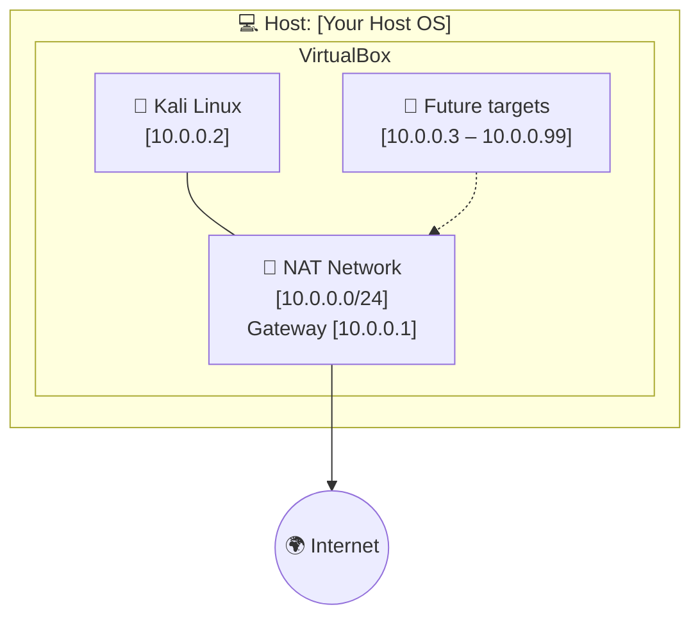
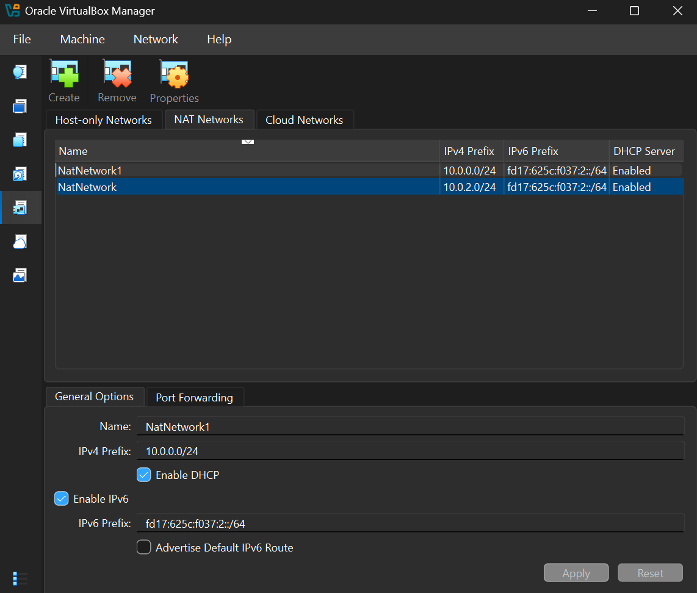
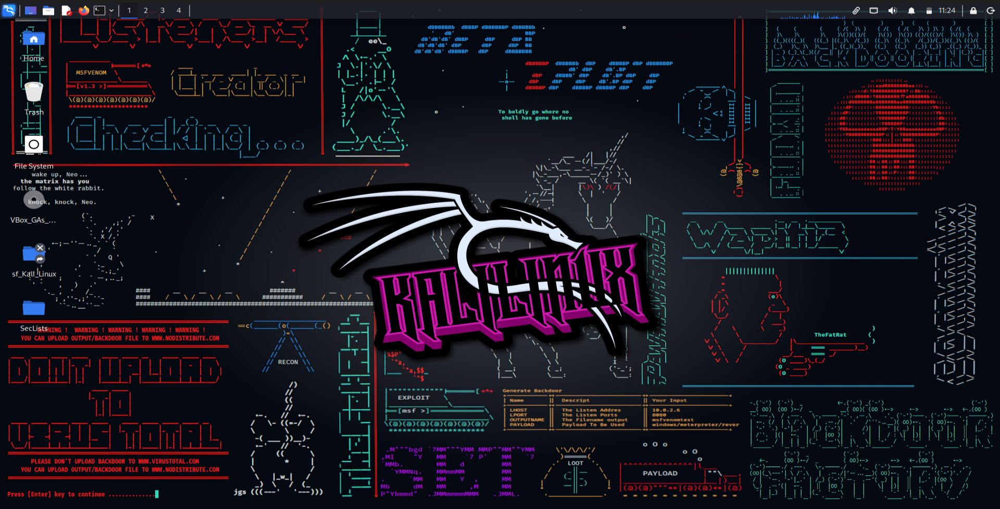
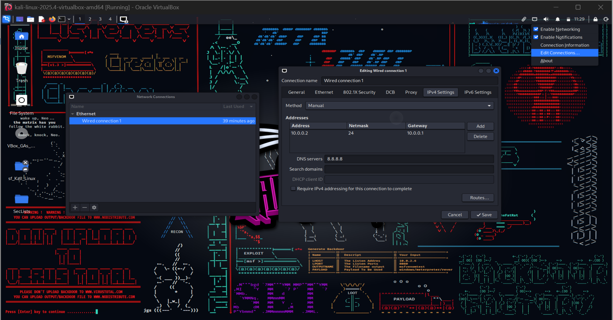

<div align="center">

# 🔐 Cybersecurity Lab Environment Setup

**An isolated VirtualBox + Kali Linux lab for penetration-testing and ethical-hacking practice**

<p align="center">
  
  
  
  
  
  
  
  
  
  
  
</p>

---

## 📌 Project Overview

This project documents how I built a **virtual cybersecurity and penetration-testing lab** using VirtualBox and Kali Linux.

The lab gives me a safe, repeatable environment to practice network scanning, reconnaissance, vulnerability assessment and other authorized security-testing activities. It runs on a private virtual network, so more machines (including intentionally vulnerable targets) can be added in future projects.

## 🎯 Objectives

- [x] Install and configure VirtualBox
- [x] Install / import Kali Linux as a virtual machine
- [x] Create a private **NAT Network** for the lab
- [x] Configure and verify network connectivity on Kali
- [x] Assign a consistent IP address to the Kali VM
- [x] Take a clean snapshot for recovery
- [x] Document the full setup process
- [ ] Add target machines *(future work)*

## 🛡️ Purpose of the Lab

The lab can be used for:

- Network reconnaissance and port scanning
- Vulnerability assessment
- Packet analysis
- Web application security testing
- Exploitation practice on machines I own
- Experimenting with security tools

> ⚠️ **Important:** This lab must only be used against systems that I own or have explicit written permission to test. Never use these tools against unauthorized systems.

---

## 🏗️ Lab Architecture



<!-- Add your own network diagram screenshot here -->
<!--  -->

Additional VMs can be attached to the same NAT Network later.

## ⚙️ Lab Configuration

| 🧩 Component | ⚙️ Configuration |
|---|---|
| 🖥️ Host OS | Windows 11 |
| 🧠 Host RAM | 16 GB |
| ⚡ Processor | Intel Core i5 |
| 🧰 Hypervisor | VirtualBox 7.2.6 |
| 🐉 Security OS | Kali Linux 2025.4 |
| 🧠 Kali RAM | 8192 MB |
| 🌐 Virtual Network | NAT Network |
| 📡 Network Address | 10.0.0.0/24 |
| 🐧 Kali IP Address | 10.0.0.2/24 |
| 🚪 Default Gateway | 10.0.0.1 |
| 🌍 DNS Server | 8.8.8.8 |
| 🔮 Reserved for future VMs | [10.0.0.3 – 10.0.0.99] |

---

## 🪜 Lab Setup Procedure

### Step 1 — Install 7-Zip
Kali's pre-built VM images are often distributed as `.7z` archives, so I installed 7-Zip to extract them.

### Step 2 — Install VirtualBox
Installed VirtualBox [version] as the hypervisor.

### Step 3 — Create the NAT Network
In **VirtualBox → Tools → Network** I created a dedicated NAT Network:

```text
Network Name : NatNetwork1
IPv4 Prefix  : 10.0.0.0/24
DHCP         : Enabled
IPv6         : Enabled
```



> **Why a NAT Network?** VMs on the same NAT Network can talk to each other *and* reach the internet through address translation. That is exactly what a multi-machine attacker/target lab needs. A plain "NAT" adapter keeps each VM isolated from the others.

### Step 4 — Import Kali Linux
Downloaded the official Kali VM from [kali.org](https://www.kali.org/get-kali/) and imported it into VirtualBox.

```text
Adapter 1
  Attached to  : NAT Network
  Network      : NatNetwork1
  Adapter Type : Intel PRO/1000 MT Desktop

RAM : 8192 MB
```



*(Optional)* A shared folder was set up to move files between the host and the VM.

### Step 5 — Configure the Kali Network
Configured a fixed IPv4 address so the machine is easy to reference in future exercises:

```text
IP Address : 10.0.0.2
Netmask    : 255.255.255.0
Gateway    : 10.0.0.1
DNS        : 8.8.8.8
```



### Step 6 — Create a Clean Snapshot
Once configuration was complete I took a snapshot named:

```text
Clean Kali - Network Setup
```

If a future exercise breaks the VM, I can roll back to this known-good baseline.

---

## 🔎 Lab Verification

| ✅ Test | 🧾 Command | 🎯 Expected Result | Result |
|---|---|---|---|
| Check IP address | `ip a` | Correct Kali IP shown | ✅ |
| Test gateway | `ping -c 4 10.0.0.1` | Replies received | ✅ |
| Test internet | `ping -c 4 8.8.8.8` | Replies received | ✅ |
| Test DNS | `nslookup google.com` | Domain resolves | ✅ |
| Verify Nmap | `nmap --version` | Version displayed | ✅ |
| Verify snapshot | Restore snapshot, run `ip a` | Baseline restored | ✅ |

<!-- Add a screenshot of your terminal output here -->
<!--  -->

---

## 🐞 Problems Encountered & Solutions

### Problem 1 — Configuring a Separate NAT Network
**Challenge I faced:** When setting up my Kali Linux virtual machine in Oracle VirtualBox, I noticed that I already had a NAT Network named NatNetwork. However, it was using the default configuration, which did not match the network settings I wanted for my lab. Instead of modifying the existing network, I decided to create a separate NAT Network named NatNetwork1 so that I could configure it according to my lab requirements.

**Solution:** I created NatNetwork1 and configured its IPv4 network prefix to 10.0.0.0/24. I also enabled DHCP and IPv6 to support the network configuration required for my lab. This allowed me to keep the existing NatNetwork separate while having another network that I could configure and manage independently for my Kali Linux environment.

---

## 💡 What I Learned

1. **NAT vs NAT Network** — I learned that NAT allows a virtual machine to access external networks through the host's connection, while NAT Network allows multiple virtual machines connected to the same NAT Network to communicate with one another and access external networks.
2. **VM networking** — I learned how VirtualBox network adapters connect virtual machines to different network types. Choosing the correct adapter mode is important for proper communication and internet access.
3. **Static IP configuration** — I learned how to manually configure an IP address, subnet mask, default gateway, and DNS server in Kali Linux. In my lab, I used 10.0.0.2 as the IP address, /24 as the subnet prefix, 10.0.0.1 as the gateway, and 8.8.8.8 as the DNS server.
4. **Snapshots** — I learned the importance of taking a snapshot of a working virtual machine before making major changes or conducting experiments. This provides a convenient way to return to a previous state if something goes wrong.
5. **Documentation** — I learned that documenting configurations, screenshots, commands, and troubleshooting steps makes a cybersecurity project easier to understand, reproduce, and maintain.
---

## 🔐 Security & Ethical Use

This lab is for **education and authorized testing only**. All activity takes place on virtual machines I own inside an isolated virtual network.

## 🔗 Tools & Resources

- **7-Zip:** <https://7-zip.org/download.html>
- **VirtualBox:** <https://www.virtualbox.org/wiki/Downloads>
- **Kali Linux:** <https://www.kali.org/get-kali/>

## 👤 Author

**Michael Kamau**

[LinkedIn](https://www.linkedin.com/in/dabon-mikey/) · [GitHub](https://github.com/404-Noir)

---

**Program:** Network Walks | **Week:** 01 | **Project:** Cybersecurity & Pentesting Lab Setup
